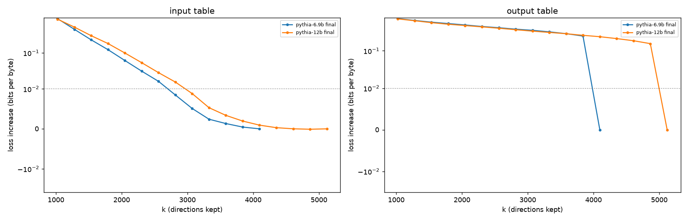
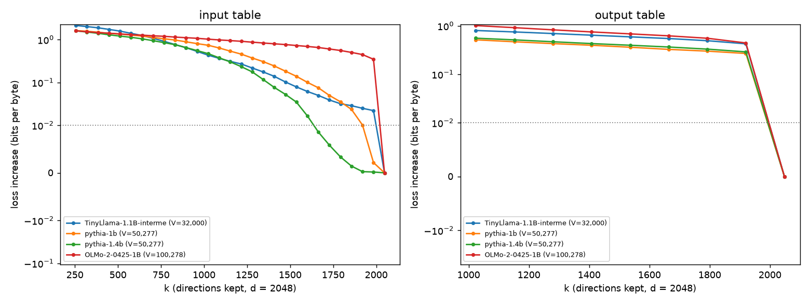

---
# Ariadne working paper 1. Draft until Andrew approves it for publication.
# Source: ariadne pieces/empty-dimensions. Publish with: scripts/publish-piece.sh pieces/empty-dimensions empty-dimensions
title: "Do Language Models Have Empty Dimensions?"
subtitle: "How many embedding directions a fixed vocabulary uses, and what token identity leaves unexplained"
date: 2026-10-09
lastmod: 2026-10-10
version: "0.3"
status: working-paper
draft: true
authors:
  - given: Andrew P
    family: Hunter
    orcid: 0009-0005-7613-8019
    affiliation: Plainsight Systems
abstract: |
  A language model's vocabulary size and embedding dimension d are chosen
  before training. I asked whether a trained embedding table uses all d
  dimensions. The Pythia suite keeps one 50,277-token vocabulary while d
  grows from 512 to 5,120, so I squashed each table onto its top k
  principal directions and measured the loss. Trailing directions are
  empty, in this paper's sense, if they can be removed together, in that
  order, for at most a stated rise in loss. The tables of Pythia 70M to 2.8B
  spread their variance over nearly all of d, yet from 1.4B parameters up the network
  does not depend on the trailing 19 to 40% of its input directions at 0.01
  bits per byte, while it depends on essentially every output direction, to within the
  sweep's step. My
  prediction that the number of input directions needed would level off at
  a value set by the vocabulary failed: from d = 2,560 up it grows with d, and after an early drop it
  grows with training.
  The trailing input directions carry values that belong to their tokens,
  so I measured identity information: the bits about which token was drawn
  that survive projection onto the top k directions and Gaussian noise
  calibrated from the model's own first block. Counted in the same basis on
  the same text, 99% of that information, averaged over the text's tokens, is in place
  before the directions the network depends on, from 410M up, and squashing to that
  point costs more than 0.1 bits per byte. In the text's frequency-weighted
  basis, identity takes 96 to 240 directions in every model while d grows
  tenfold; a count from Shannon's 1949 sphere-packing bound does not
  predict that number better than a constant. I propose that what the
  network uses its further directions for is the grammar, and set out a
  test on a constructed language, modelled on a toddler's, whose
  statistics are known before training.
keywords: [embedding dimension, vocabulary, language models, information theory, constellation-constrained capacity, Pythia]
---

## Introduction {#sec:intro}

This paper asks whether a language model's embedding table uses all the dimensions it is given. It is the first entry in Ariadne, a research program that starts from Shannon and asks why the numbers in a model that are chosen and tuned are what they are.

The vocabulary is one of those numbers, and the question is older than language models. In the founding paper, next to his definition of redundancy, Shannon set the size of a vocabulary against it: "The Basic English vocabulary is limited to 850 words and the redundancy is very high," while "Joyce on the other hand enlarges the vocabulary and is alleged to achieve a compression of semantic content" [@shannon1948a, p. 399]. The size of a vocabulary was tied to how much a message carries from the start. Shannon did not derive the size, and the vocabularies of today's models are still chosen rather than derived.

A language model makes the question concrete. Its designers choose a vocabulary of \(V\) tokens and an embedding dimension \(d\), and training fills in two \(V \times d\) tables: the input table, whose rows place each token in the network's embedding space, and the output table, whose rows score the network's state against each token. My working idea is that \(V\) and \(d\) together set how much the learned language can express, and that \(d\) should follow from the vocabulary and the grammar. Before running anything I wrote down what that predicts: if \(d\) is chosen by convention rather than derived, then at a fixed vocabulary it will usually be larger than the table needs, and the trained table will leave some of its dimensions empty.

This paper compares three properties of a trained embedding table:

- its **geometric spread**: how evenly its rows vary across the \(d\) dimensions;
- its **functional dependence**: how many principal directions the trained network depends on, measured by removing them and watching the loss;
- its **identity information**: how many bits about which token was drawn survive a stated noise channel, computed from the table alone.

The third gives a baseline for the second: it says how many directions a reader would need if all it had to do was tell tokens apart. The main result is that the network depends on more. From 410M parameters up, 99% of the identity information sits in the leading 384 to 1,536 input directions, at noise calibrated from the model. The network depends on more than 973 of 1,024 directions at 410M, and on 1,664 to 3,072 from 1B up. The paper ends on what the directions between the two counts hold, and @sec:next designs an experiment to answer it.

I report what I found in the order I found it, because each stage raised the next question. Where it helps, what I saw is kept apart from what I make of it, so a reader can disagree with the reading without losing the observation. Verification detail is in the appendices.

## Setup and definitions {#sec:setup}

**Models and text.**

- **Pythia** [@biderman2023pythia]: eight models from 70M to 12B parameters, trained on the same data in the same order for about 300B tokens, with one tokenizer of 50,277 tokens (the standard run, not the deduplicated one). The embedding dimension takes the values 512, 768, 1,024, 2,048, 2,560, 4,096 and 5,120, and depth and the number of attention heads change with it. Pythia-1B and Pythia-1.4B share \(d = 2{,}048\) and differ in depth (16 against 24 layers) and heads (8 against 16), which makes them a useful control. Their input and output tables are separate parameters, which the code checks.
- **Two other families** at \(d = 2{,}048\), used in @sec:need and Appendices B and C: TinyLlama 1.1B [@zhang2024tinyllama], with 32,000 tokens (its 3T-token intermediate checkpoint, step 1,431k), and OLMo-2 1B [@olmo2025], with 100,278 tokens.
- **Text:** the WikiText-103 test set [@merity2016]. The Pythia runs read its first 16 windows of 1,024 tokens (16,384 tokens); the cross-family runs and the role classes read its first 70,000 characters. Each comparison uses the same text throughout.
- **Loss** is measured in bits per byte, so that models with different tokenizers are comparable. Vocabulary sizes are the token counts of the released tokenizers, the tables' padding rows are excluded, and weights are used in full precision at pinned revisions.

**Terms.** I use a few words in one sense each throughout.

- The **embedding space** is \(\mathbb{R}^d\), where a table's rows \(w_v\) live, and \(d\), its **dimension**, is the number of coordinates in each row. "The dimension" means \(d\); in the plural, "dimensions" counts the coordinates of a space, and "empty dimensions" (below) names trailing directions.
- A **direction** is a unit vector in that space. A table's **principal directions** \(u_1, \dots, u_d\) are the eigenvectors of the covariance of its centered rows, ordered by their eigenvalues \(\lambda_1 \ge \dots \ge \lambda_d\), the **variances** along them. The top \(k\) span a \(k\)-dimensional subspace, and **keeping \(k\) directions** means projecting the rows onto it.

**The squash test.** Let \(\mu\) be the mean of a table's trained rows and \(U_k = [u_1, \dots, u_k]\) its top \(k\) principal directions, with every row weighted equally. **Squashing** the table onto those directions replaces every row by the mean plus the projection of the centered row onto their span:

\[
w_v^{(k)} = \mu + U_k U_k^{\top} (w_v - \mu).
\]{#eq:squash}

Squash one table, leave the other as trained, run the model on the evaluation text, and record \(L(k)\), the loss in bits per byte. With \(L_0\) the unmodified model's loss, the **directions needed** at tolerance \(\tau\) is

\[
k^*(\tau) = \min\{\, k \in K : L(k) - L_0 \le \tau \,\},
\]{#eq:kstar}

where \(K\) is the set of values of \(k\) in the sweep. The count is only as fine as the sweep: assuming the loss does not increase as \(k\) grows between measured points, the true smallest \(k\) lies above the measured point below \(k^*(\tau)\). At the measured points the loss decreases in every sweep up to \(k^*(0.003)\); above that, the few reversals are under 0.0002 bits per byte. The main tolerance is \(\tau = 0.01\) bits per byte. I also report 0.003, 0.03 and 0.1, because the count depends on the tolerance and the tolerance is my choice.

**Empty dimensions.** At a tolerance \(\tau\), the **empty dimensions** of a table are the trailing principal directions \(u_{k^*+1}, \dots, u_d\), which can be removed together, in this order, without the loss rising by more than \(\tau\). "Empty" is a statement about what one trained network depends on, on one text, not a claim that those directions hold no information: they can hold values that belong to their tokens (@sec:tail).

## Geometric spread and functional dependence {#sec:need}

**Spread.** I started with how the trained rows are laid out. With \(q_i = \sqrt{\lambda_i} / \sum_j \sqrt{\lambda_j}\) the normalized singular values of the centered table, the entropy effective rank [@roy2007] is

\[
\operatorname{erank} = \exp\Big(-\sum_i q_i \ln q_i\Big),
\]{#eq:erank}

which runs from 1, when all the variance lies along one direction, to \(d\), when the standard deviation is the same along every direction. In Pythia 70M to 2.8B, where I computed it, both tables reach 91 to 98% of \(d\). A Gaussian table of the same shape, with each row scaled to the length of the corresponding centered trained row, reaches 99% or more. So the vocabulary spreads its variance over nearly every dimension it is given. That does not mean the network uses every direction: rows can vary along a direction the network ignores. To find out which directions matter, I had to ask the network.

### What the network depends on

**The input table has empty dimensions in the larger models.** Up to \(d = 1{,}024\) it has none: removing even the weakest 5% of input directions costs more than 0.01 bits per byte (@fig:loss). That 5% is the last step the sweep takes below \(d\); it keeps 2, 5, 10, 20 and so on up to 90, 95 and 100% of the directions. From Pythia-1.4B up, the trailing 19 to 40% of the input directions can be removed together for 0.01 bits per byte: 19% at 1.4B, 35% at 2.8B, 31% at 6.9B and 40% at 12B (@tbl:need). At 1B the share is 3%.

{#fig:loss}

| Model | \(d\) | +0.1 | +0.03 | +0.01 | +0.003 | \(k^*/d\) at +0.01 |
|---|---|---|---|---|---|---|
| Pythia-1B | 2,048 | 1,664 | 1,856 | 1,984 | 1,984 | 0.97 |
| Pythia-1.4B | 2,048 | 1,408 | 1,600 | 1,664 | 1,856 | 0.81 |
| Pythia-2.8B | 2,560 | 1,344 | 1,472 | 1,664 | 1,856 | 0.65 |
| Pythia-6.9B | 4,096 | 2,048 | 2,560 | 2,816 | 3,328 | 0.69 |
| Pythia-12B | 5,120 | 2,048 | 2,560 | 3,072 | 3,840 | 0.60 |

: Input directions needed, \(k^*(\tau)\), at four tolerances in bits per byte. Steps of 64 directions for 1B to 2.8B, 256 for 6.9B and 12B. {#tbl:need}

At the same \(d\), the two 2,048-dimensional models differ: Pythia-1B needs 1,984 directions and Pythia-1.4B, deeper and with twice the heads, needs 1,664.

**The output table has no empty dimensions, to within each sweep's step.** At every Pythia size up to 12B, removing the last step of output directions already costs more than 0.01 bits per byte (@fig:loss-large). Dropping the weakest 5% of output directions costs 0.08 to 0.42 bits per byte across Pythia 70M to 2.8B. I leave that as an observation: the output table reads the network's full state, so squashing it tests what that state needs, not what the vocabulary needs.

{#fig:loss-large}

**My plateau prediction failed.** I expected the number of input directions needed to level off at a value set by the vocabulary as \(d\) grew. It did not. At 0.01 bits per byte it rises from \(d = 2{,}560\) on: 1,664 at 2,560, 2,816 at 4,096, 3,072 at 5,120, which is 60 to 70% of \(d\) in those three models. At the looser tolerances, 0.1 and 0.03, Pythia-6.9B and 12B need the same number, 2,048 and 2,560 directions, to within the 256-direction steps of that sweep.

Two further comparisons point the same way (details in Appendix B):

- **Training.** Across Pythia-2.8B's checkpoints the count first drops, then grows. At 0.01 bits per byte it is 1,920 directions at step 1,000, close to the random start, 1,408 at step 8,000 and 1,664 at the final step. At 0.1 bits per byte it is 768, 640 and 1,408.
- **Vocabulary.** At \(d = 2{,}048\) and 0.1 bits per byte, a 32K-token vocabulary (TinyLlama) needs about as many input directions as Pythia's 50K, and a 100K-token vocabulary (OLMo-2) needs essentially all of them. These families also differ in training data, length, architecture and recipe, so the comparison does not isolate vocabulary size.

**What I made of it.** At a fixed vocabulary the input table has empty dimensions in Pythia-1.4B and larger, and a few (3% of \(d\)) in Pythia-1B, so the first prediction holds there on the input side. The plateau failure matters more to me than the slack. The number of input directions needed is not a property of the vocabulary alone: it rises with \(d\) in the larger models, differs between two models of the same \(d\), and grows with training. It belongs to the trained network.
Removable directions are not new; what this test measures is. Earlier work removes directions to compress a model or a word embedding and checks that performance survives, or estimates how many dimensions the rows occupy:

- truncating word embeddings to their leading principal components keeps task performance [@raunak2019], and removing the few leading ones can improve it [@mu2018allbutthetop];
- SliceGPT deletes low-variance principal directions of the activations throughout a network, the embedding dimension included, removing up to 25% of the parameters of Llama-2 70B, OPT 66B and Phi-2 while keeping 99, 99 and 90% of their zero-shot task performance, with recovery fine-tuning for Llama-2 70B and Phi-2 [@ashkboos2024slicegpt];
- ALBERT trains models whose input embedding is factorized through a dimension much smaller than the hidden size [@lan2020albert];
- on the output side, zeroing 30 to 40% of the coordinates of output embeddings, Pythia-2.8B's among them, keeps generated text close to the unpruned model's by a MAUVE score above 0.80 [@cho2025]; that test removes coordinate axes rather than principal directions and accepts far more change than 0.01 bits per byte;
- nearest-neighbour estimators put the intrinsic dimension of Pythia's input embeddings at about 25 to 120 [@kataiwa2025], and at about 10 to 17 at each of the six sizes from 160M to 12B once the shortest 10% of rows, a hub near the origin, are removed [@quemy2026]. These are local geometric dimensions of the rows, far below the number of directions the network depends on.

The squash test differs from all of these in what it changes and what it measures. It changes one table, after training, in that table's own basis, and leaves the rest of the model as trained. It measures what the trained network depends on, not how far the table can be compressed.

## What the trailing directions contain {#sec:tail}

The squash test throws the trailing directions away and records the damage. It does not say what they hold. Maybe their values are **token-independent variance**, variance whose assignment to particular tokens does not matter. Maybe they carry something that belongs to each token.
For the input tables of Pythia 1.4B, 2.8B, 6.9B and 12B, split each centered row into two components: its projection onto the top \(k^*(0.1)\) principal directions, the **core**, and its projection onto the remaining directions, the **tail**. I then changed the tail components and left everything else in the model as trained:

- **zeroed**: the squash test at \(k^*(0.1)\);
- **shuffled**: the tail components permuted across tokens, so that almost every token gets another token's whole tail, with the same values and variance but the wrong owner;
- **random**: independent Gaussian values, keeping the variance along each tail direction.

As a control, I shuffled the core components instead.

The central comparison is the trained tail against the shuffled one. The two hold the same set of values; only which token owns which value differs. If the tail held only token-independent variance, shuffling it would not matter.

| Pythia | Core | As trained | Shuffled | Zeroed | Random | Core shuffled |
|---|---|---|---|---|---|---|
| 1.4B | 1,408 | 0.863 | 0.961 | 0.940 | 0.960 | 3.629 |
| 2.8B | 1,344 | 0.806 | 0.888 | 0.878 | 0.894 | 3.711 |
| 6.9B | 2,048 | 0.777 | 0.899 | 0.838 | 0.888 | 3.826 |
| 12B | 2,048 | 0.744 | 1.032 | 0.844 | 1.047 | 3.570 |

: Loss in bits per byte with the input table's tail components as trained, shuffled across tokens, zeroed, or replaced by matched random values, and with the core components shuffled instead as a control. Core gives the number of core directions, \(k^*(0.1)\). One shuffle and one random draw per model (seed 0); at 1.4B and 2.8B ten further draws of each are summarized in the text, and with the single draw 2.8B's shuffled losses run from 0.888 to 0.915. {#tbl:tail}

**What I saw.** The assignment matters. Shuffling the tail costs 0.08 to 0.29 bits per byte more than the trained tail, in every model (@tbl:tail).

A wrong tail also costs more than no tail: slightly at 1.4B and 2.8B, and clearly at 6.9B and 12B, where at 12B zeroing the tail costs 0.10 bits per byte and shuffling it 0.29. Because the margins at 1.4B and 2.8B are small, I repeated the test there with ten shuffles and ten random draws each, under a rule set before the run. Every draw cost more than zeroing:

- 1.4B: shuffled 0.951 to 0.977 and random 0.945 to 0.975 bits per byte, against 0.940 zeroed;
- 2.8B: shuffled 0.892 to 0.915 and random 0.884 to 0.902, against 0.878.

This second comparison is weaker evidence than the first. Variation the network does not expect can cost more than none, whatever the values mean. Shuffling the core destroys the model.

The tail also separates tokens that the core places close together. I measure closeness by the angle between two tokens' centered rows: the smaller the angle, the more their directions coincide and the harder they are to tell apart from direction alone. For each token in the evaluation text, I took its nearest neighbour by angle using the core components only, then added the tail components back and measured how much the angle between the pair widened. On average it widens most for surface variants of one word, which differ only in case or a leading space; less for pairs that share a stem; and least for different words. That order holds in every model. In Pythia-2.8B the pairs separated most include punctuation, digits and function words, such as "." and "," or " was" and " were" (Appendix C).

That surface variants start out close is consistent with prior work: adding one average transformation vector to a base form's input embedding, for capitalization as for inflection, gives a vector that models read as the variant [@reif2026vocabdiet].

**What I made of it.** The tail is not token-independent variance: its values belong to their tokens. That suggested an answer I could test, that the tail carries identity, the fine distinctions that tell one token from its nearest neighbours. The squash test could not settle that, because it measures what one network depends on, tangled up with everything the network does downstream. I needed a quantity computed from the table on its own.

## Identity information {#sec:identity}

### The definition

Think of the table as a codebook a sender uses and a receiver reads through noise.

**The codebook.** Each token \(v\) has a row \(w_v \in \mathbb{R}^d\). The codebook is fixed by two choices:

- a distribution \(p(v)\) over tokens: uniform over the vocabulary, or the frequency of \(v\) in a stated text, in which case the codebook is the tokens that occur there (3,536 tokens in the 16,384-token Pythia text);
- an ordered orthonormal basis \(b_1, \dots, b_d\), with \(B_k = [b_1, \dots, b_k]\).

Given \(p\), the rows are centered on \(\mu_p = \sum_v p(v)\, w_v\), with covariance \(\Sigma_p = \sum_v p(v)(w_v - \mu_p)(w_v - \mu_p)^{\top}\). A token's coordinates in the first \(k\) directions are \(x_v^{(k)} = B_k^{\top}(w_v - \mu_p) \in \mathbb{R}^k\). Every result states which \(p\) and which basis it uses; @tbl:views lists the three combinations that matter.

**The channel.** Draw a random token \(T \sim p\) and observe the coordinates of its projection through Gaussian noise:

\[
Y_k = x_T^{(k)} + Z, \qquad Z \sim \mathcal{N}(0, \sigma^2 \mathrm{Id}_k), \qquad \sigma = \varepsilon\, s, \qquad s^2 = \operatorname{tr}\Sigma_p / d.
\]{#eq:channel}

Here \(s^2\) is the mean variance per direction, so the **noise scale** \(\varepsilon\) has no units: at \(\varepsilon = 4\), the noise variance is 16 times the mean variance per direction.

**Identity information** is the mutual information between the token and what the receiver sees in the first \(k\) directions,

\[
I(k) = I(T; Y_k) = H(T) - H(T \mid Y_k) \quad \text{bits}, \qquad I(0) = 0.
\]{#eq:identity}

It is a property of the codebook, \(p\) and the noise, averaged over tokens, not of any one row. "99% of identity" below means \(I(k) \ge 0.99\, I(d)\): an average information criterion, not 99% recognition accuracy and not a guarantee about prediction loss.

**The measure and its density.** Because the subspaces are nested and \(I(k)\) never decreases (Appendix A), \(I\) is the cumulative mass of a measure on the direction indices, with density

\[
\Delta I(k) = I(k) - I(k-1) = I\big(T; [Y_k]_k \,\big|\, Y_{k-1}\big),
\]{#eq:density}

the bits the \(k\)-th coordinate of \(Y_k\), written \([Y_k]_k\), adds given the ones before it. Two consequences follow. The density depends on the order of the directions, because every increment is conditional on those before it. And the mass of a set of directions that is not an initial segment is a sum of conditional increments, not the identity information of that set's span. The exact density is positive along every direction in which the codebook varies under \(p\) (Appendix A); an estimate can still be indistinguishable from zero within its sampling error.

**Ceiling.** A Gaussian input with the codebook's covariance would carry

\[
C(k) = \sum_{i=1}^{k} \tfrac12 \log_2\!\left(1 + \lambda_i / \sigma^2\right)
\]{#eq:ceiling}

bits per use of this channel, when the basis is the principal directions of \(\Sigma_p\) and \(\lambda_i\) are their variances. In any other basis the ceiling is \(\tfrac12 \log_2 \det(\mathrm{Id}_k + \Sigma_k / \sigma^2)\), with \(\Sigma_k\) the covariance under \(p\) of the first \(k\) coordinates. Either way \(I(k) \le C(k)\), strictly whenever \(x_T^{(k)}\) takes at least two values under \(p\), and \(I(k) \le H(T)\) (Appendix A).

**Estimation.** The posterior over tokens is exact for this channel,

\[
p(v \mid y) \propto p(v) \exp\!\left(-\lVert y - x_v^{(k)} \rVert^2 / 2\sigma^2\right),
\]{#eq:posterior}

so \(H(T \mid Y_k)\) is estimated by Monte Carlo: draw a token and a noise vector, form \(y\), and average \(-\log_2 p(T \mid y)\) over draws, evaluating the posterior over every token in the codebook. No density of \(Y\) has to be estimated, and each estimate is unbiased. The same draws are used at every \(k\). Reported errors on differences between points use those paired draws; that covers the matched comparison's gains and threshold margins, the grid-of-16 run and the shared information \(R\). Other reported errors are pointwise. Errors cover the Monte Carlo draws only, not the choice of text, the noise level or \(k^*(\tau)\). Draw counts are in Appendix E.

**Relationship to prior work.** The mathematics is established; what is new is where it is pointed and how it is read. The pieces:

- At a fixed \(k\) with equal probabilities, \(I(k)\) is the capacity \(C^*\) of a set of equiprobable discrete signals on the Gaussian channel [@ungerboeck1982, eq. 5], now usually called the constellation-constrained capacity, which that paper evaluates by Monte Carlo for one- and two-dimensional signal sets. With unequal probabilities it is the mutual information of a constellation whose points are used with nonuniform probabilities, as in shaping [@kschischang1993], except that here the text fixes \(p\) rather than a designer choosing it.
- The split by classes below is the chain rule over set-partition levels that multilevel coding rests on [@wachsmann1999].
- The log-determinant ceiling is the mutual information of the vector Gaussian channel with a Gaussian input, the same form as the coding rate in maximal coding rate reduction [@yu2020mcr].
- Adding noise to make mutual information meaningful for a deterministic map follows @goldfeld2019. Estimating Gaussian-smoothed entropy after a PCA projection has made mutual information estimable in high dimensions [@greenewald2023]; there the projection is a device for estimation, here it is the object of study.
- Probing treats what a representation reveals about a linguistic property as mutual information [@pimentel2020] and asks how few dimensions of an embedding carry it [@torrobahennigen2020]. Identity information instead fixes the channel and reads the codebook itself, with no trained probe.

What I did not find in prior work, in a search that was not exhaustive, is the sweep over nested principal subspaces, its reading as a measure with a density per direction, and its comparison with what a network depends on. Ordering the directions by variance is itself a choice. How much syntactic information a principal component of a word embedding carries does not track the variance it explains [@raunak2020]. And for channels with discrete inputs, the optimal power allocation over parallel Gaussian channels is not waterfilling [@lozano2006], and the optimal precoder is generally not diagonal in the channel's eigenbasis [@perezcruz2010].

**Classes.** Partition the tokens with a function \(g\), and let \(G = g(T)\). By the chain rule, identity splits exactly into two parts:

- a **between-class** part \(I_B(k) = I(G; Y_k)\): which class;
- a **within-class** part \(I_W(k) = I(T; Y_k \mid G)\): which token within the class.

I used two partitions:

- **surface variants**: tokens that differ only in case and surrounding whitespace share a class, such as " The", "The" and "the";
- **grammatical role**: the 12-tag universal part-of-speech set [@petrov2012] plus a whitespace class. Weighted by the text, each token type takes the tag it most often receives in context; uniform over the vocabulary, it takes a lexicon's tag (Appendix C).

### What I saw

At a chosen noise scale of \(\varepsilon = 4\), uniform over the vocabulary:

- the Pythia input tables carry 6 to 14 of their 15.6 bits of token identity in their top 64 principal directions (@fig:identity);
- from 1B up, \(I(k)\) reaches 99% of \(I(d)\) by 256 to 384 directions, while the squash test, in the same basis, needs 1,664 to 3,072;
- from 410M up, the input table carries more identity than the output table in its leading directions (9.5 against 7.2 bits in the top 64 at 1B, 14.3 against 9.2 at 12B); at 70M and 160M the output table carries more (7.4 and 7.3 against 6.2 bits).

The count depends on the noise. At \(\varepsilon = 8\), the models from 1B up need 1,280 to 1,792 directions.

![Identity information along the number of principal directions kept, input tables, \(\varepsilon = 4\). Top, uniform over the vocabulary; bottom, weighted by the evaluation text, in its own frequency-weighted basis. Left, total identity in bits; middle and right, the between-class and within-class parts for surface-variant classes, each as a share of its value in all \(d\) dimensions. The panel titles use the repository's terms: "dictionary view" is uniform over the vocabulary, "text view" weighted by the evaluation text, and "eps" is \(\varepsilon\). Of the two \(d = 2{,}048\) curves, red is Pythia-1B and purple Pythia-1.4B.](figures/identity-info.png){#fig:identity}

The class split shows what the measure can resolve (Appendix C). The comparison is between half-fill points: the smallest measured \(k\) at which a part reaches half its own value at \(k = d\).

- With surface-variant classes, the within-class part (which variant of a word) reaches its half-fill point before the between-class part (which word) in 78 of 96 cases, and never after.
- With grammatical-role classes, weighted by the text, role reaches its half-fill point before the word within the role in 53 of 60 cases, and never after. Uniform over the vocabulary there is no consistent order.

These roles are static: each token type has one role. They are not the contextual grammar the paper's closing hypothesis is about, and they are not a partial test of it.

**What I made of it.** At \(\varepsilon = 4\), the leading few hundred directions hold nearly all of a token's identity, the network depends on far more, and the tail components are token-specific. So the tail holds something that belongs to each token and is not needed, beyond the leading directions, to tell tokens apart at that noise. That reading had three weaknesses, and each became a measurement in @sec:pinned:

- it depended on a chosen noise;
- it compared a count weighted uniformly over the vocabulary with a loss measured on text, where frequent tokens dominate;
- the ordered measure cannot see identity the tail carries redundantly, as a copy of what the leading directions already resolve. Whatever the tail holds, its share is bounded by \(I(d) - I(k) \le H(T \mid Y_k)\), which is near zero once the leading directions resolve the token.

## Identity versus functional dependence {#sec:pinned}

### Noise calibrated from the model

A language model reads its input table only through the residual stream. At the input to the second block, a reader sees the token's row \(w_{v_t}\) plus what the first block added at that position, \(a_t = h_1(t) - w_{v_t}\), where \(h_1(t)\) is the residual stream at position \(t\) after the first block. That addition depends on the context as well as the token, and the part the token does not determine is interference for a reader trying to recover which token it is. I calibrate the channel's noise to it:

\[
\sigma_{\text{res}}^2 = \frac{1}{d}\operatorname{tr}\big(\text{pooled within-token covariance of } a_t\big),
\]{#eq:sigmares}

the variance per coordinate of \(a_t\) around its mean for the same token, pooled over the token types that occur at least twice in the evaluation text. I defined it, and committed the definition, before computing any value with it. Write \(s_u\) for the scale \(s\) of @eq:channel with \(p\) uniform over the vocabulary; in this section \(\varepsilon\) means \(\sigma / s_u\) unless stated otherwise.

The calibration rests on assumptions that go with every result below:

- the context-driven part of the first block's output is treated as noise for identity, although it carries context;
- it is approximated as isotropic and Gaussian, although it is neither;
- one noise level is used for every token, although the pooled estimate is dominated by frequent tokens;
- only the first block is counted. The definition as committed said later blocks would add more, so this would be the least interference. I have since weakened that: later readers face a cumulative addition I did not measure, which need not be larger;
- it comes from one text;
- the codebook stays the table's rows, although a reader at the second block sees \(w_v + \mathbb{E}[a_t \mid v_t = v]\). That token-determined shift has a spread per coordinate of about 7.7 to 20.5 times \(s_u\), derived from the total and within-token variances of \(a_t\).

So the identity measured here is the table's, read through the interference a second-block reader faces, not the identity of what that reader receives.

A related variance has been read the other way. Abrahao groups hidden states at layer \(L-1\), in that paper's notation, by the token that comes next, on WikiText-103's validation and training splits with Pythia 70M to 6.9B among 14 models, and reads the variance within a group as information the representation stores rather than noise [@abrahao2026]. That grouping is by the predicted token, not the input token; here the context-driven part counts as interference only for a reader whose task is the input token's identity. Input tokens are also known to keep much of their identity through a transformer's layers, at least in BERT [@brunner2020identifiability].

Residual-stream interference gives \(\varepsilon_{\text{res}} = \sigma_{\text{res}} / s_u\) of 2.2 to 2.7 for Pythia-70M to 410M and 3.5 to 4.2 from 1B up, so the \(\varepsilon = 4\) of @sec:identity was in the range the models set. Counting the token-determined part of \(a_t\) as well gives 8.1 to 20.8. For reference, the rounding error of the stored 16-bit tables, spread evenly over one unit in the last place, is \(\varepsilon = 2.1 \times 10^{-4}\). At that level every input table resolves 99% of identity by \(k = 8\), the smallest \(k\) measured.

### Three ways of counting

The squash test orders directions by variance over the whole vocabulary and measures loss on text. Identity can be counted under three pairings of token weighting and direction order, and only one of them matches the squash test on both:

| Comparison | Token weighting \(p\) | Direction order | Scale \(s\) |
|---|---|---|---|
| Dictionary identity | uniform over the vocabulary | the squash test's (vocabulary-wide PCA) | \(s_u\) |
| Identity against the network's count | evaluation-text frequencies | the squash test's (vocabulary-wide PCA) | \(s_t\) |
| Frequency-weighted identity | evaluation-text frequencies | principal directions of \(\Sigma_p\) | \(s_t\) |

: The three pairings. In every case the noise is held at the same absolute \(\sigma_{\text{res}}\); the text view's own scale \(s_t\) is 8 to 10% smaller than \(s_u\) (\(s_t / s_u\) = 0.900 to 0.923), so in its terms \(\varepsilon\) = 2.39 to 4.67. {#tbl:views}

In the dictionary pairing, identity at \(\sigma_{\text{res}}\) reaches 99% by 112 to 384 directions in all eight models, on a grid of 16 with up to 64,000 draws (Appendix D); a coarser 4,000-draw run put the cut one grid step later at 70M and 1B.

### The matched comparison

The text view has 3,536 token types and \(H(T) = 9.43\) bits, and \(I(d)\) at \(\sigma_{\text{res}}\) is at least 99.8% of it in every model. Let \(k_{q}\) be the smallest measured \(k\) with \(I(k) \ge q\, I(d)\); I report \(q\) = 0.95, 0.99 and 0.999, because the cut is my choice. The decision rule, written before the run and committed with its results (@sec:interp), was that the gap holds for a model if \(k_{0.99}\) is at least one measured point below \(k^*(0.01)\).

| Pythia | \(d\) | \(k_{0.95}\) | \(k_{0.99}\) | \(k_{0.999}\) | \(k^*(0.01)\) | \(I(d) - I(k_{0.99})\), bits |
|---|---|---|---|---|---|---|
| 70M | 512 | 384 | 512 | 512 | 512 (all) | 0 |
| 160M | 768 | 384 | 768 | 768 | 768 (all) | 0 |
| 410M | 1,024 | 128 | 384 | 768 | 1,024 (all) | 0.041 ± 0.003 |
| 1B | 2,048 | 768 | 1,536 | 1,984 | 1,984 | 0.072 ± 0.008 |
| 1.4B | 2,048 | 512 | 1,024 | 1,536 | 1,664 | 0.050 ± 0.006 |
| 2.8B | 2,560 | 384 | 768 to 1,024 | 1,536 | 1,664 | 0.092 ± 0.002 (at 768) |
| 6.9B | 4,096 | 256 | 512 | 1,280 | 2,816 | 0.068 ± 0.002 |
| 12B | 5,120 | 256 | 384 | 768 | 3,072 | 0.075 ± 0.007 |

: Directions identity needs, weighted by the evaluation text and in the squash test's basis, at the receiver's noise \(\sigma_{\text{res}}\), against the directions the network needs at 0.01 bits per byte (@tbl:need). "All": the sweep, in steps of 5 to 10% of \(d\), needed more than 95% of the directions, and \(k^*\) is taken as \(d\). ± is one standard error over the Monte Carlo draws. Pythia-2.8B's \(k_{0.99}\) is unresolved between 768 and 1,024 at 64,000 draws. {#tbl:pinned}

{#fig:gap}

**What I saw.** The gap holds from 410M up (@tbl:pinned, @fig:gap). By the rule it does not hold in 70M and 160M. There both counts fall in the last grid step, so a gap of up to about 127 directions at 70M or 255 at 160M is not excluded.

Both counts sit on grids, so their ratio \(k^*(0.01)/k_{0.99}\) is known only to an interval:

- above 2.5 at 410M, where \(k^*\) is known only to exceed 973;
- \((1.25, 1.55)\) at 1B;
- \((1.56, 2.17)\) at 1.4B;
- \((1.56, 3.25)\) at 2.8B;
- \((5.0, 7.3)\) at 6.9B;
- \((7.3, 12)\) at 12B.

Read after the fact, the gap is larger at 6.9B and 12B than at 1B to 2.8B; among those three, the 1.4B and 2.8B intervals overlap and 1B's lies below both. At 1B the gap also depends on the cut: \(k_{0.999}\) equals \(k^*(0.01)\).

Squashing the input table to \(k_{0.99}\), measured directly, costs more than 0.1 bits per byte in every model from 410M up, as the rule set for this check required: 0.78 at 410M, 0.14 at 1B, 0.47 at 1.4B, 1.33 at 2.8B (0.87 at 1,024, the other end of its interval), 1.73 at 6.9B and 1.61 at 12B. In 70M and 160M, \(k_{0.99}\) is \(d\). Keeping 99% of identity is far from keeping what the network depends on.

**What I made of it.** At the noise level calibrated from the first block, on the text the loss is measured on, and in the squash test's basis, the network depends on more input directions than token identity needs, from 410M up.

Call the directions between \(k_{0.99}\) and \(k^*(0.01)\) the **intermediate block**. Together with all directions after it, it adds at most \(I(d) - I(k_{0.99})\): under 1% of identity by construction, with point estimates of 0.041 to 0.092 of 9.43 bits. Yet the network depends on it.

The block overlaps the tail of @sec:tail, because \(k^*(0.1)\) lies inside it in every tail model:

- its lower part, from \(k_{0.99}\) to \(k^*(0.1)\), is core;
- its upper part, from \(k^*(0.1)\) to \(k^*(0.01)\), is tail.

The tail tests and the redundancy test below cover the upper part together with all directions beyond \(k^*(0.01)\). They isolate neither portion, and they do not examine the lower part separately. Whether the block duplicates identity the leading directions already carry, which a reader that is not Bayes-optimal might use, was not measured.

### Basis dependence

In the text's own frequency-weighted basis, identity needs far fewer directions. On a grid of 16, 99% of identity at \(\sigma_{\text{res}}\) takes 96 to 240 directions in every model, while \(d\) grows tenfold, from 512 to 5,120 (@tbl:basis, @fig:gap). In the squash test's basis it takes 2.7 to 6.4 times as many, comparing the coarse grid's measured points with the grid of 16.

My reading is that directions ordered by variance over all 50,277 tokens are ordered largely by tokens the text rarely uses. Frequency weighting is known to matter for an embedding space's geometry: most methods for correcting that geometry implicitly assume uniform word frequencies, and PCA whitening weighted by the empirical frequencies improves task performance over them [@yokoi2024]. The squash test removes directions in the vocabulary-wide order, so its counts carry the same dependence, and a different order could change which directions look needed.

| Pythia | \(d\) | \(k_{0.99}\), weighted basis | count from Shannon's bound, \(n_{\text{flat}}\) |
|---|---|---|---|
| 70M | 512 | 160 | 122 |
| 160M | 768 | 144 | 117 |
| 410M | 1,024 | 96 | 81 |
| 1B | 2,048 | 240 | 291 |
| 1.4B | 2,048 | 208 | 248 |
| 2.8B | 2,560 | 176 | 267 |
| 6.9B | 4,096 | 144 | 202 |
| 12B | 5,120 | 144 | 220 |

: Directions identity needs in the text's frequency-weighted basis at \(\sigma_{\text{res}}\), on a grid of 16 directions (\(H(T) = 9.43\) bits), and Shannon's count of @eq:nflat. At 70M and 6.9B the 99% cut did not separate from its neighbour at 64,000 draws. {#tbl:basis}

### Shannon's count

Shannon counted dimensions too, those of the channel. In "Communication in the Presence of Noise" he represented signals as points in a space of \(n = 2WT_0\) dimensions, for band \(W\) and duration \(T_0\), and bounded how many of them can be told apart through white Gaussian noise: at most \(\big(\sqrt{(P+N)/N}\,\big)^{n}\), with \(P\) and \(N\) the average signal and noise power, an argument for many dimensions and vanishing error [@shannon1949, p. 17, eq. 21]. Turned around, telling \(M\) signals apart needs at least about \(2\log_2 M / \log_2(1 + P/N)\) dimensions. Put the table's mean variance per direction in place of \(P\), the receiver's noise in place of \(N\), and the token entropy in place of \(\log_2 M\):

\[
n_{\text{flat}} = \frac{2\, H(T)}{\log_2\!\big(1 + 1/\varepsilon^2\big)}, \qquad \varepsilon = \sigma_{\text{res}} / s,
\]{#eq:nflat}

with \(s = s_t\) weighted by the text and \(s_u\) uniform over the vocabulary. The count uses three quantities: the token entropy, the receiver's noise and the table's mean variance per direction. Two things about it need saying:

- putting \(H(T)\) in place of \(\log_2 M\) is not Shannon's step for unequal probabilities. What @eq:nflat is exactly is the \(k\) at which the Gaussian ceiling of a table whose every principal direction had variance \(s^2\) reaches \(H(T)\);
- it is a heuristic for these tables, not a bound, because their spectra are far from flat.

The counting form is not new:

- the same volume argument bounds the dimension that embedding-based retrieval needs, with a margin in place of noise and the number of top-\(m\) subsets of the documents in place of the number of messages [@weller2026, sec. 3, thm. 1];
- Yin and Shen choose the dimension of word embeddings from their signal against estimation noise [@yin2018];
- random projections in the manner of Johnson and Lindenstrauss give a count of order \(\log V\) for a distortion \(\delta\) of every pairwise distance, with a constant that grows as \(\delta^{-2}\) in their proof [@johnson1984]: a worst-case guarantee with no noise level.

On the coarse grid used for @tbl:pinned, the frequency-weighted cut points (256 in seven models, 128 at 410M) could not tell the count from a constant. So I measured them on the grid of 16 in @tbl:basis, with a rule committed before the run: the count carries information beyond a constant only if its mean \(\lvert \ln(n_{\text{flat}} / k_{0.99}) \rvert\) over the eight models is below that of the best single constant.

The count fails. Its ratio to the measured count runs from 0.76 to 1.53, but its mean log error, 0.274, is larger than the 0.199 of the best constant (any value from 144 to 160 directions). It loses whichever end of their grid intervals the two cuts that did not separate (70M, 6.9B) take, and it also fails at the other cuts and uniform over the vocabulary (Appendix D). So the directions identity needs are, for now, a number I can measure and not one I can derive. Why they stay between 96 and 240, and what sets the differences between models, is open.

### Does the tail duplicate the core?

The ordered measure cannot see identity the tail carries redundantly, so I measured the tail on its own, with the core and tail of @sec:tail, uniform over the vocabulary, at \(\varepsilon_{\text{res}}\). Let \(Y_{\text{core}}\) and \(Y_{\text{tail}}\) be the coordinates in those directions plus independent Gaussian noise. Given the token they are independent, so the identity both resolve is their **shared information**,

\[
R = I(T; Y_{\text{core}}) + I(T; Y_{\text{tail}}) - I(T; Y_d) = I(Y_{\text{core}}; Y_{\text{tail}}) \ge 0.
\]{#eq:shared}

The tail alone resolves 10.4 of 15.6 bits at 1.4B, 14.0 at 2.8B and all of it at 6.9B and 12B, and \(R\) is within 0.01 bits of that. The overlap is forced, not made. Exactly, \(I(T; Y_{\text{tail}}) - R = I(T; Y_{\text{tail}} \mid Y_{\text{core}}) \le H(T) - I(T; Y_{\text{core}})\), which is estimated at no more than 0.033 bits, so \(R \approx I(T; Y_{\text{tail}})\) whatever the tail holds.

How much the tail resolves is bounded by its variances: \(I(T; Y_{\text{tail}}) \le \min(H(T), C_{\text{tail}})\), where \(C_{\text{tail}} = \sum_{i > k^*(0.1)} \tfrac12 \log_2(1 + \lambda_i / \sigma_{\text{res}}^2)\) is the ceiling of @eq:ceiling over the tail directions (11.3 bits at 1.4B, 18.5 at 2.8B). I compared the true tail with an independent Gaussian code with each tail direction's variance, one draw per case:

- over the whole vocabulary, the random code resolves slightly more identity than the true tail wherever the tail does not already resolve the token (10.79 against 10.42 bits at 1.4B, 14.26 against 13.98 at 2.8B);
- over the 24,074 tokens with a lexicon role, where the random code keeps the variances over all tokens, the true tail resolves slightly more in several cases.

So, over the whole vocabulary, the tail resolves no more identity than a random code with its variances, and slightly less. The copy is there, but it is not evidence of structure the network put in the tail.

## Discussion and limitations {#sec:interp}

**What the evidence establishes.**

- At a fixed vocabulary, the input table has empty dimensions in the larger models, and the output table has none to within each sweep's step.
- The number of input directions the network depends on is not set by the vocabulary. From \(d = 2{,}560\) up it grows with \(d\), with depth and width changing together; after an early drop it grows with training; and it differs between models of the same \(d\).
- In the 1.4B to 12B input tables, the trailing directions carry values that belong to their tokens.
- At noise calibrated from the model, on the text the loss is measured on and in the squash test's basis, the network depends on more input directions than token identity needs, from 410M up: 5 to 12 times more at 6.9B and 12B on the 99% cut, and 1.25 to 3.25 times more at 1B to 2.8B.
- In the text's own basis, identity needs 96 to 240 directions while \(d\) grows tenfold, and the simplest derivation of that number from Shannon fails.

**What the intermediate directions might hold.** Nothing here has tested what the intermediate block holds. My candidate is the grammar. Identity information treats each token as an independent draw from \(p\), so, weighted by the text, the entropy it accounts for is the token analogue of Shannon's \(F_1\), the entropy of single symbols. In "Prediction and Entropy of Printed English", \(F_N\) is the entropy of the next letter given the \(N - 1\) before it, and as \(N\) grows it approaches the entropy of the language [@shannon1951, p. 51, eqs. 1 and 2]. A network that predicts text has to carry what \(F_1\) leaves out: what each token does to the state that the next prediction depends on.

Two alternatives have to be ruled out:

- **Bigram statistics.** In trained models of up to 1B parameters, subnetworks that predict the next token from the current one alone are concentrated in the first MLP layer, and remain critical to performance even when they make up under 0.2% of the non-embedding parameters (in Pythia-1B and GPT-2 large) [@chang2025].
- **Accessibility rather than content.** The network may use a redundant or more easily read copy of distinctions the leading directions already carry, which a Bayes-optimal reader would not need, or it may depend on graded similarity, how alike two tokens are, rather than on whether they differ.

A test of the grammar hypothesis has to separate what a token does to the state from what it predicts on its own and from how readily it can be read.

**Dependence after training is not what a new network must have.** The squash test measures what a trained network depends on; a different experiment asks what a network must have. Bochkov replaces a 1.7B-class model's input table with the fixed 16-bit binary expansion of each token's ID, tiled to the model's width, with no trainable input parameters [@bochkov2026]. It trains to a working model, below a learned-table control on most evaluations, in single runs; the control also has 100.7M more trainable parameters. On WikiText it scores 0.79 bits per byte against the control's 0.76 [@bochkov2026, Table 3]. The setups differ in model, tokenizer, data and evaluation protocol, so the numbers are not comparable with this paper's. The point they support is narrower: at a tolerance of a few hundredths of a bit per byte, a network trained without learned input directions beyond identity can do their work elsewhere. So if the grammar is what the intermediate block holds in Pythia, it need not live in the input table of every receiver.

**How dependence develops.** Across Pythia-2.8B's checkpoints, the number of input directions needed first falls from near the random start, then grows through training (Appendix B). In Pythia-12B and the original OLMo-7B, the vocabulary embeddings converge early in training to high correlations with semantic and syntactic features, while their alignment with frequency rank grows gradually throughout [@papadimitriou2025]. The embeddings of high-frequency and function words also reach their final vectors sooner than those of lexical and low-frequency words, an effect the authors cannot attribute to frequency or function separately. That is context for the growth, not a connection to it, and identity across checkpoints was not measured.

**Limitations.**

- **One family, one text.** The Pythia suite and the WikiText-103 test set carry most of the results; two other families appear at one size and differ in more than vocabulary.
- **Chosen tolerances, cuts and order.** Every squash count depends on the loss tolerance and every identity count on the share of identity required; at 1B the gap closes at 99.9%. The squash test is linear and follows one direction order; a different basis or a nonlinear compression might keep what the network depends on in fewer dimensions.
- **The noise is a calibration, not a measurement of any reader's task.** Its assumptions are listed with its definition.
- **Grids and draws.** The larger models were swept in steps of 256 directions; for Pythia-70M to 410M the squash sweep needed more than 95% of the directions, the sweep's last step below \(d\), so their \(k^*\) is taken as \(d\). The tail tests on the loss use one shuffle and one random draw at 6.9B and 12B, where the margins are large, and ten of each at 1.4B and 2.8B. The random-code comparison for the tail's identity is one draw per case.
- **When the rules were set.** The definition of the noise was committed before any value was computed with it. The decision rule for the matched comparison was written before running but committed with the results, so its order cannot be checked from the history. The rule for Shannon's count was committed before its fine-grid run; the count's form, and the coarse comparison that prompted the rule, were set after the coarse cut points were known.

The paper does not claim a natural embedding dimension (the plateau prediction failed), a theory of how networks work, that removable directions or the parts of identity information are new, that the tail holds no identity, that the intermediate block holds nothing, or that it holds the grammar.

## Conclusion and next experiment {#sec:next}

Shannon did not start from English. He built it up from constructed sources whose statistics he knew, and he modelled the transmitter and the receiver as finite-state transducers with "a finite number \(m\) of possible states", proving that a non-singular one keeps the source's entropy rate exactly [@shannon1948a, sec. 8, pp. 399--400, Theorem 7]. The next experiment follows the same method.

The models I probed learned languages too advanced to start from. Even the difference between "was" and "were" is advanced. A two-year-old's language is not, and I live with one. My daughter uses "bubble" for about five different things, a vocabulary smaller than the world it names, which developmental linguists call overextension [@rescorla1980]. She learned "here you go" from me saying it with her name when I handed her things, and now she says it whether she is giving or receiving; when she is the one receiving, she fills the name in with whoever is handing it to her: "here you go da da." As I read it, she is using a frame attached to the event of handing something over, with a slot for the other person. That interpretation motivates the constructed language below. Early word combinations built around a fixed word or phrase with an open slot are well documented [@braine1963; @lieven1997; @tomasello2003].

The next experiment came from watching her, and its tools come from developmental linguistics as much as from information theory. It builds a language like hers on purpose:

- a small world of people, objects and actions;
- a vocabulary smaller than the world, with controlled overextension;
- a handful of frames with slots;
- known probabilities.

It will be a unifilar finite-state source, one whose state is determined by its start and the words so far. That fixes the vocabulary, the token frequencies and the contextual structure, and makes the source's entropy rate, its states and its \(F_N\) exact before any model sees it. Where feasible, pairs of sources will match in vocabulary and in single-token and bigram statistics while differing in longer-range dependencies, so that the grammar hypothesis is tested against bigram prediction rather than alongside it.

The source's statistics are known in advance, but the identity profile of a learned embedding table still has to be measured after training, unless the codebook is fixed. So receivers will be trained at the same widths with a learned input table and with a fixed identity code. If the fixed-code receiver reaches the same performance at the same width, learned input embeddings are not necessary for that result. Comparing the two receivers will test whether learning the table changes the width required to exploit the source's contextual structure. Before any of that, I will check identity information on a toy product codebook with exact answers: independent coordinates under \(p\) (uniform over the corners of a box with distinct side lengths, say) and isotropic noise, so that its identity information is a sum of one-dimensional terms, each computable by quadrature to any precision.

The question the experiment tests is whether the number of directions a receiver needs splits into a part set by identity and a part set by the grammar, and whether the directions beyond both stay empty. One earlier result informs the design: on languages generated by known probabilistic automata, the rank of the generating automaton has a stronger effect on how well models learn the language than the number of states or symbols does [@borenstein2024], so the designed sources will vary rank as well as states.

## Data and code {-}

Code, pinned model revisions and result files are at <https://github.com/plainsight-systems/ariadne> (release `empty-dimensions-v0.3`), under `experiments/c-empty-dimensions/`; the paper's source is under `pieces/empty-dimensions/`.

| Item | Script | Result file |
|---|---|---|
| Effective rank | `measure.py` | `results/phase1.json` |
| @tbl:need, @fig:loss, @fig:loss-large | `project.py`, `refine.py` | `results/phase2.json`, `results/phase3_fine.json`, `results/phase3_large.json` |
| Checkpoints, cross-family (Appendix B) | `refine.py`, `cross_vocab.py` | `results/phase3_checkpoints.json`, `results/cross_vocab.json` |
| @tbl:tail, tail separation (Appendix C) | `semantic_core.py`, `claim_checks.py` | `results/semantic_core.json`, `results/claim_checks.json` |
| @fig:identity, class split | `identity_info.py`, `identity_info_xvocab.py`, `identity_roles.py` | `results/identity_info.json`, `results/identity_info_xvocab.json`, `results/identity_roles.json` |
| \(\sigma_{\text{res}}\) | `pinned_noise.py` | `results/pinned_noise.json` |
| Dictionary identity at \(\sigma_{\text{res}}\) | `identity_pinned.py` | `results/identity_pinned.json` |
| @tbl:pinned, loss at \(k_{0.99}\) | `identity_pinned_text.py`, `claim_checks.py` | `results/identity_pinned_text.json`, `results/claim_checks.json` |
| @tbl:basis, Shannon's count (Appendix D) | `identity_fine.py`, `capacity_count.py` | `results/identity_fine.json`, `results/capacity_count.json` |
| Redundancy and the tail's ceiling | `tail_identity.py`, `tail_capacity.py` | `results/tail_identity.json`, `results/tail_capacity.json` |
| @fig:gap | `plot_identity_vs_need.py` | the files for @tbl:need, @tbl:pinned and @tbl:basis |

: Where each result comes from, under `experiments/c-empty-dimensions/`. {#tbl:code}

## References {-}

::: {#refs}
:::

## Appendix A: Properties of identity information {-}

These hold for the exact quantity; the estimates carry sampling error on top.

1. **Monotone.** \(I(k)\) never decreases in \(k\): the subspaces are nested, so \(Y_k\) is \(Y_{k+1}\) with its last coordinate dropped, and by data processing \(I(T; Y_k) \le I(T; Y_{k+1})\). So the density is never negative, and \(I\) is the cumulative mass of the measure with point masses \(\Delta I(j)\).
2. **Bounded by the source.** \(I(k) \le H(T) \le \log_2 V\).
3. **Bounded by the Gaussian ceiling.** \(I(T; Y_k) = h(Y_k) - h(Z)\). Because \(\Sigma_k\), the covariance of \(x_T^{(k)}\), is taken under the channel's own \(p\), \(Y_k\) has covariance \(\Sigma_k + \sigma^2 \mathrm{Id}_k\), and for a given covariance the Gaussian has the largest differential entropy, so \(I(k) \le \tfrac12 \log_2 \det(\mathrm{Id}_k + \Sigma_k/\sigma^2)\), which is @eq:ceiling in the principal directions of \(\Sigma_p\). The gap is strictly positive whenever \(x_T^{(k)}\) takes at least two values under \(p\): \(Y_k\) is then a mixture of at least two Gaussians with distinct means and equal covariance, which is not Gaussian (by Cramér's decomposition theorem, if \(Y_k = x_T^{(k)} + Z\) were Gaussian, with \(Z\) Gaussian and independent of \(T\), then \(x_T^{(k)}\) would be Gaussian, and a variable with finitely many values is not Gaussian unless it is constant), so \(h(Y_k)\) is strictly below the Gaussian maximum, which only a Gaussian attains.
4. **Positive density.** The exact density is positive for every direction with nonzero variance under \(p\): the posterior given \(Y_{k-1}\) gives every token positive weight, so \(T\) and \([Y_k]_k\) could be independent given \(Y_{k-1}\) only if \([x_v^{(k)}]_k\) were the same for every token with \(p(v) > 0\).
5. **Exact split.** \(I(k) = I_B(k) + I_W(k)\), by the chain rule, because \(G\) is a function of \(T\).
6. **Invariance.** The profile \(I(k)\) is invariant under translation, under joint orthogonal transformation of the codebook and its ordered basis, and under nonzero uniform rescaling with \(\sigma\) scaled by the same absolute factor, so results at a fixed \(\varepsilon\) compare tables at matched relative noise. Rotating the codebook while holding an arbitrary basis fixed can change every partial profile; \(I(d)\) alone is unchanged. When the basis is principal directions, the choice of basis within a subspace of repeated eigenvalues can likewise change the partial profile.

## Appendix B: Squash-test details {-}

**Checkpoints.** At Pythia-2.8B's checkpoints (steps 1,000, 8,000, 16,000, 33,000, 66,000, 100,000 and 143,000), the count at 0.01 bits per byte is 1,920 directions at step 1,000, when the table is still close to its random start, 1,408 from step 8,000 to 33,000, 1,536 at 66,000 and 1,664 from 100,000. At 0.1 bits per byte it is 768 at step 1,000, 640 at step 8,000 and 1,408 at the final step. Between steps 100,000 and 143,000 it does not change to within the sweep's step of 128 directions. The slowdown late in training looks like the learning-rate schedule rather than the language running out; it rests on one model and seven checkpoints. Only the final checkpoints of the Pythia suite are used for the identity measurements.

**Cross-family comparison.** @tbl:vocab and @fig:vocab compare three vocabularies at \(d = 2{,}048\). At 0.1 bits per byte, the 32K and 50K vocabularies need 1,370 to 1,601 of the 2,048 input directions and do not separate from each other; the 100K vocabulary needs more than 1,984 even at that loose tolerance: removing its weakest 64 input directions costs 0.35 bits per byte, and the 2,030 in @tbl:vocab is interpolated across that last step. In all four models, removing the weakest 128 output directions costs 0.27 to 0.44 bits per byte. These families differ in training data, length, architecture and recipe as well as vocabulary.

{#fig:vocab}

| Model | \(V\) | Tokens | In +0.1 | In +0.03 | In +0.01 | Out +0.01 |
|---|---|---|---|---|---|---|
| TinyLlama | 32,000 | 3T | 1,479 | 1,828 | 2,019 | 2,045 |
| Pythia-1B | 50,277 | 300B | 1,601 | 1,821 | 1,921 | 2,043 |
| Pythia-1.4B | 50,277 | 300B | 1,370 | 1,553 | 1,652 | 2,044 |
| OLMo-2 1B | 100,278 | ~4T | 2,030 | 2,042 | 2,046 | 2,045 |

: Directions needed at \(d = 2{,}048\) for the input table (In) and output table (Out), with training tokens, on the first 70,000 characters of the WikiText-103 test set. These counts are interpolated linearly between measured points (input every 64 directions from 256, output every 128 from 1,024), so they differ slightly from @tbl:need, which takes the smallest measured \(k\) on an almost identical span (16,384 tokens against 70,000 characters, both from the start of the test set). OLMo-2's input counts, TinyLlama's at +0.01, and all the output counts fall inside the last measured step below \(d\) and do not resolve individual directions. {#tbl:vocab}

## Appendix C: The tail's separations and the class split {-}

**What the tail separates.** For each token that occurs in the evaluation text, I found its nearest neighbour among those tokens by the cosine of their core components, then measured how much adding the tail components pushes the pair apart: the cosine of the angle between their core components minus the cosine of the angle between their full centered rows. Pairs are surface variants if they match after lowercasing and stripping whitespace, and share a stem if they share a prefix of at least four characters covering at least 60% of the shorter one. The push is largest for surface variants, smaller for shared stems and smallest for different words in every model (Pythia-12B: 0.110, 0.094 and 0.075 in cosine), and it grows with model size. It also follows how close the pairs start: divided by the mean core cosine of its class, the mean push is about the same or slightly larger for different words (Pythia-12B: 0.24, 0.24 and 0.29). In Pythia-2.8B, the pairs it pushes apart most include punctuation, digits and function words the core places close together, for example these four (core cosines 0.48 to 0.69): “.” and “,”, “ was” and “ were”, “ the” and “ to”, “ 0” and “ 1”. Restoring each centered row's length after zeroing the tail helps in three models and hurts in one, 2.8B.

**Half-fill comparison.** The **half-fill point** of each part is the smallest measured \(k\) at which it reaches half of its value in all \(d\) directions, \(k_{B,\frac12} = \min\{k : I_B(k) \ge \tfrac12 I_B(d)\}\) and \(k_{W,\frac12}\) likewise, over the measured values of \(k\) (8, 16, 32, 64, 128, 256, 384, and so on). Each part is compared with its own total, so the comparison does not depend on how many bits each part holds. With surface-variant classes, the within-class part reaches its half before the between-class part in 78 of 96 cases (eight models, two tables, two weightings, three noise scales), at the same measured \(k\) in the other 18, and never later; the order holds in TinyLlama and OLMo-2 as in Pythia. With grammatical-role classes, weighted by the first 70,000 characters of the evaluation text, role reaches its half before the word within the role in 53 of 60 cases (ten models, two tables, three noise scales), at the same measured \(k\) in the other 7, and never later; at \(\varepsilon = 4\), role is half-filled by 8 to 16 directions (32 for OLMo-2's input table) and the word within the role by 32 to 64. Uniform over the vocabulary, roles come from a lexicon that covers 34 to 48% of each vocabulary; tokens without a known role are left out, and \(\mu_p\), \(\Sigma_p\), its principal directions and \(s\) are recomputed on the covered tokens. There the order is not consistent: role first in 11 cases, tied in 27, word first in 22. The text-weighted results use the frequency-weighted basis, so they are not compared with the squash test's counts.

## Appendix D: Shannon's count, further detail {-}

| Pythia | \(d\) | \(n_{\text{flat}}\), text | \(k_{0.95}\) | \(k_{0.99}\) | \(k_{0.999}\) | \(n_{\text{flat}}\), dictionary | \(k_{0.99}\), dictionary |
|---|---|---|---|---|---|---|---|
| 70M | 512 | 122 | 112 | 160 | 272 | 174 | 256 |
| 160M | 768 | 117 | 96 | 144 | 224 | 161 | 208 |
| 410M | 1,024 | 81 | 64 | 96 | 144 | 115 | 112 |
| 1B | 2,048 | 291 | 160 | 240 | 352 | 393 | 384 |
| 1.4B | 2,048 | 248 | 128 | 208 | 336 | 350 | 304 |
| 2.8B | 2,560 | 267 | 112 | 176 | 288 | 374 | 240 |
| 6.9B | 4,096 | 202 | 96 | 144 | 224 | 281 | 144 |
| 12B | 5,120 | 220 | 96 | 144 | 208 | 306 | 128 |

: Shannon's count against the directions identity needs at \(\sigma_{\text{res}}\), on a grid of 16 directions. \(k_{0.95}\), \(k_{0.99}\) and \(k_{0.999}\): weighted by the text, frequency-weighted basis, \(H(T) = 9.43\) bits. Dictionary: uniform over the vocabulary, \(H(T) = 15.62\) bits. The 99% cut did not separate from its neighbour at 64,000 draws at 70M and 6.9B (text) and 160M (dictionary). {#tbl:nflat}

**The rule and the other cuts.** The rule also set a per-model band, \(0.8 \le n_{\text{flat}} / k_q \le 1.25\); in the primary test four models fall inside it (160M, 410M, 1B, 1.4B). The count fails at the 95% and 99.9% cuts, and uniform over the vocabulary, where at 99% it matches the best constant to three decimals but does not beat it (0.3524 against 0.3520, from unrounded counts), and at 99.9% the cut points of 1B, 1.4B and 2.8B lie beyond the grid's 512 and are set to \(d\); the count loses for any value of those three in \((512, d]\).

**Readings after the fact,** not part of the rule. A version of the count rescaled by one fitted factor also loses to the constant (0.230 against 0.199), so the failure is in how the count varies between models, not only in its scale. Any constant from about 130 to 195 beats the unscaled count. The count's scale is roughly right with nothing fitted to the identity measurements (0.76 to 1.53 times the measured count), while the bound from each table's own spectrum, the smallest \(k\) at which the ceiling of @eq:ceiling reaches \(0.99\, I(d)\), is 7.6 to 24 times below the measured count in the frequency-weighted basis and 2.7 to 3.6 times below it uniform over the vocabulary.

## Appendix E: Draws and precision {-}

Monte Carlo estimates of identity used 4,000 draws of token and noise, shared across \(k\). Where a 99% cut point was not two standard errors clear of 0.99 \(I(d)\) at the cut and at the grid point before it, the draws were raised to 16,000 and then 64,000. In the matched comparison (@tbl:pinned) that applied to 410M (16,000) and to 2.8B and 6.9B (64,000), and in the frequency-weighted basis on the coarse grid to 160M and 12B (16,000). At 64,000 draws, Pythia-2.8B's \(k_{0.99}\) in the squash test's basis is still unresolved between 768 and 1,024. On the grid of 16, the draws used for each model are recorded in `results/identity_fine.json`; the cut did not separate at 64,000 at 70M and 6.9B (text) and 160M (uniform). Standard errors of identity estimates at 64 directions, uniform over the vocabulary at \(\varepsilon = 4\), are 0.04 to 0.07 bits.
